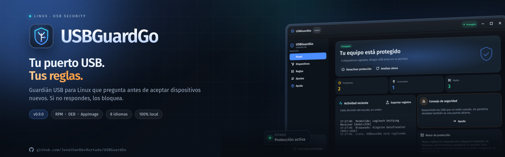
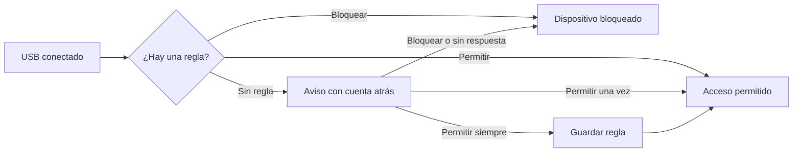
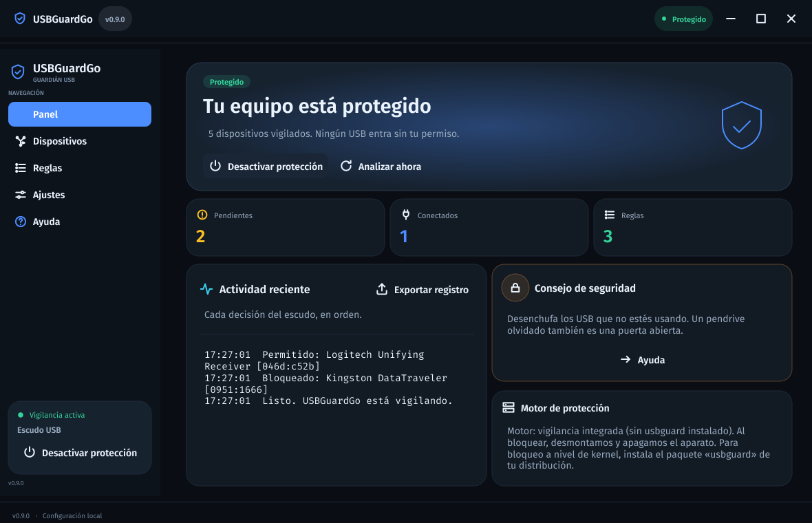
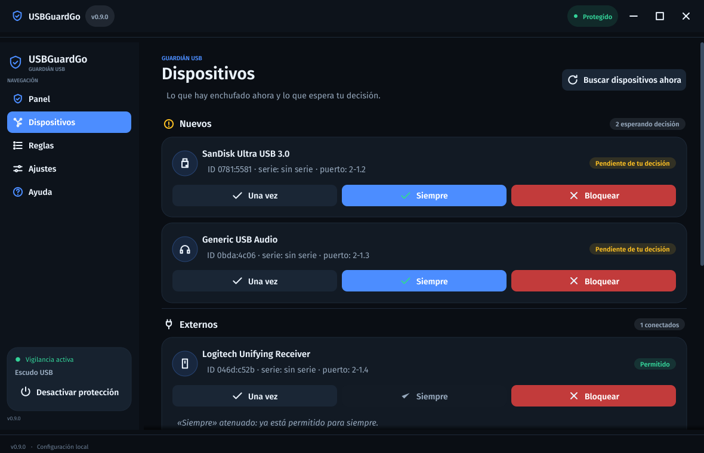
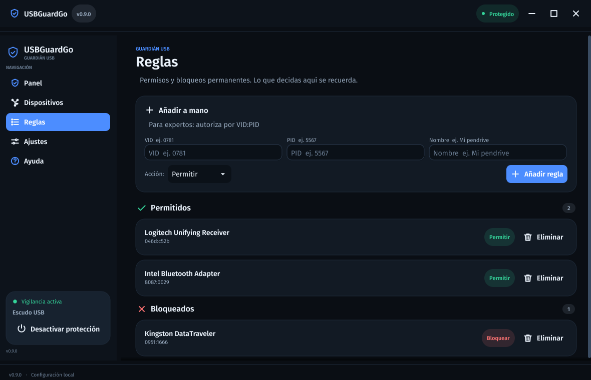

<p align="center">
  
</p>

<p align="center">
  <a href="https://github.com/JonathanDevHurtado/USBGuardGo/releases/latest"></a>
  
  
  
  
</p>

<h1 align="center">USBGuardGo</h1>

<p align="center">
  <strong>Tu puerto USB. Tus reglas.</strong><br>
  Guardián USB gráfico para Linux que te pide permiso antes de aceptar un dispositivo nuevo.
</p>

<p align="center">
  <a href="#instalación">Instalación</a> ·
  <a href="#cómo-funciona">Cómo funciona</a> ·
  <a href="#capturas">Capturas</a> ·
  <a href="#preguntas-frecuentes">FAQ</a> ·
  <a href="docs/">Documentación</a> ·
  <a href="SECURITY.md">Seguridad</a>
</p>

---

## Qué es USBGuardGo

USBGuardGo es una aplicación de escritorio para Linux que vigila los puertos USB y **pregunta antes de aceptar cualquier dispositivo que no esté autorizado**. No intenta adivinar si un pendrive es peligroso: convierte cada conexión desconocida en una decisión explícita tuya.

Si enchufas un USB nuevo, aparece un aviso con tres opciones claras:

- **Permitir una vez** — funciona solo mientras el dispositivo esté conectado.
- **Permitir siempre** — se guarda como regla permanente para tus aparatos de confianza.
- **Bloquear** — se neutraliza y se recuerda para la próxima vez.

Si no respondes dentro del tiempo configurado, **se bloquea automáticamente**. El silencio nunca se interpreta como un sí.

## El problema que resuelve

La mayoría de los sistemas montan un USB desconocido en cuanto lo detectan. Un pendrive puede contener un instalador malicioso, un teclado puede presentarse como otro tipo de dispositivo y un ataque BadUSB puede actuar en segundos. Muchas veces el usuario no ve nada hasta que ya es tarde.

USBGuardGo pone una decisión consciente entre el puerto y el sistema:

| Situación | Sin USBGuardGo | Con USBGuardGo |
|---|---|---|
| USB desconocido | Se monta sin preguntar | Aparece un aviso con cuenta atrás |
| No estás delante | Se acepta por defecto | Se bloquea por defecto |
| Dispositivo de confianza | Hay que confiar cada vez | Regla permanente reutilizable |
| Dispositivo sospechoso | Hay que expulsarlo a mano | Bloqueo y regla de bloqueo |
| Quieres revisar el historial | No hay registro | Registro local exportable |

## Cómo funciona

1. **Observa.** Vigila los puertos USB mediante `sysfs`, sin necesidad de permisos de root. Si el demonio `usbguard` está instalado, también puede delegar en él para aplicar bloqueos a nivel de kernel.
2. **Reconoce.** Compara cada dispositivo con tus reglas por identificador `VID:PID` y, cuando está disponible, por número de serie. Las reglas con serie exacta tienen prioridad.
3. **Pregunta.** Si no hay una regla que lo cubra, muestra el aviso con el nombre, el tipo y el identificador del aparato, junto con una cuenta atrás.
4. **Actúa.** Permite el acceso, crea una regla permanente o bloquea el dispositivo. Si nadie responde, bloquea.
5. **Aplica.** Con `usbguard` utiliza el bloqueo del kernel; sin él, usa el bloqueo suave: desmonta las particiones y apaga el dispositivo mediante `udisksctl`.



> **Fail-closed:** lo desconocido no se acepta solo. El permiso siempre es un acto deliberado.

### La primera vez

En el primer arranque, USBGuardGo registra como de confianza los dispositivos que ya están conectados (teclado, ratón, cámara, etc.) para no llenarte de avisos imposibles de resolver. Después puedes revisar, editar o borrar esas reglas en **Reglas**.

### Protección en segundo plano

Cerrar la ventana **no apaga la protección**: la oculta en la bandeja del sistema y el monitor sigue trabajando. Desde el icono de la bandeja puedes mostrar la ventana, activar o desactivar la protección y salir del todo. Si eliges el arranque automático, la aplicación empieza oculta en la bandeja.

## Capturas

| Panel | Dispositivos |
|---|---|
|  |  |

| Reglas | Ajustes |
|---|---|
|  |  |

<p align="center">
  
</p>

La interfaz **Aurora** combina el azul de Zorin OS con el grafito cálido y el naranja de Pop!_OS. Usa Fira Sans y Fira Mono, navegación lateral, tarjetas redondeadas y controles de ventana al estilo Windows 11. Está disponible en **español, English, 中文, Русский, Deutsch, Português, 한국어 y العربية**, con cambio de idioma al instante.

## Instalación

Descarga la última versión desde **[Releases](https://github.com/JonathanDevHurtado/USBGuardGo/releases/latest)** y elige el paquete de tu distribución. Todos los artefactos son para **Linux x86_64**.

### Fedora y derivados — RPM

```bash
sudo dnf install ./usbguardgo-0.9.0-1.fc44.x86_64.rpm
```

### Debian / Ubuntu / derivados — DEB

```bash
sudo apt install ./usbguardgo_0.9.0_amd64.deb
```

### AppImage — cualquier distribución

```bash
chmod +x USBGuardGo-0.9.0-x86_64.AppImage
./USBGuardGo-0.9.0-x86_64.AppImage
```

El AppImage necesita FUSE 2. En Fedora: `sudo dnf install fuse-libs`. En Debian/Ubuntu: `sudo apt install libfuse2`.

### Flatpak

```bash
flatpak install --user ./USBGuardGo-0.9.0.flatpak
flatpak run io.github.jonathandevhurtado.usbguardgo
```

### Binario portable

```bash
tar -xzf usbguardgo-0.9.0-linux-amd64.tar.gz
cd usbguardgo-0.9.0-linux-amd64
./usbguardgo
```

### Verificar la descarga

Cada release incluye `SHA256SUMS.txt`. Descárgalo junto al paquete y comprueba la huella:

```bash
sha256sum -c --ignore-missing SHA256SUMS.txt
```

La línea de tu archivo debe terminar en `OK`. Si falla, vuelve a descargar el paquete.

### Dependencias recomendadas

USBGuardGo funciona por sí solo, pero aprovecha estas herramientas del sistema:

| Componente | Para qué sirve | Fedora | Debian / Ubuntu |
|---|---|---|---|
| `usbguard` | Bloqueo a nivel de kernel | `sudo dnf install usbguard` | `sudo apt install usbguard` |
| `udisks2` | Bloqueo suave: desmontar y apagar | `sudo dnf install udisks2` | `sudo apt install udisks2` |
| `usbutils` | Respaldo de detección con `lsusb` | `sudo dnf install usbutils` | `sudo apt install usbutils` |
| `notify-send` | Avisos de escritorio | `sudo dnf install libnotify` | `sudo apt install libnotify-bin` |

El Panel indica siempre en qué modo estás: **protección por usbguard** o **vigilancia integrada**.

## Primeros pasos

1. Abre **USBGuardGo** desde el menú de aplicaciones.
2. En el primer arranque, revisa la lista de dispositivos ya conectados que se han marcado como de confianza.
3. Enchufa un USB nuevo y elige **Permitir una vez**, **Permitir siempre** o **Bloquear**.
4. Ajusta los segundos de espera en **Ajustes → Tiempo de espera** (5–300 s).
5. Si quieres que arranque con el equipo, activa **Arrancar al iniciar sesión**. Lo hará oculto en la bandeja.
6. Cierra la ventana cuando quieras: la protección sigue activa.

### Elegir bien

- Usa **Permitir una vez** para el USB de un amigo o un dispositivo prestado.
- Usa **Permitir siempre** solo para aparatos que controlas y usas habitualmente.
- Usa **Bloquear** ante cualquier cosa que no reconozcas. Si te equivocas, puedes borrar la regla en **Reglas**.

## Privacidad

- **Sin telemetría por defecto.** La opción existe, está apagada y solo cuenta números agregados (permisos, bloqueos, tipos de fallo). Nunca envía nombres, números de serie ni identificadores.
- **Todo se queda en tu equipo.** La configuración y el registro viven en `~/.config/usbguardgo/` con permisos `600` y carpeta `700`.
- **Sin conexiones de red.** USBGuardGo no contacta con servidores para funcionar.
- **Registro exportable.** Solo sale del equipo si tú pulsas **Exportar registro** y compartes el archivo.

Puedes borrar todo desde **Ajustes → Olvidar todo y empezar de cero** o con `usbguardgo --reset-config`.

## Seguridad

USBGuardGo aplica varias capas de defensa:

- Bloqueo por defecto ante cualquier dispositivo no autorizado.
- Reglas con coincidencia exacta por serie cuando está disponible.
- Comandos externos sin shell, con argumentos separados y tiempo límite.
- Guardado atómico de la configuración y permisos restrictivos.
- Permisos temporales de sesión que nunca se escriben en disco.
- Registro local con rotación para auditar qué ocurrió.

**Importante:** USBGuardGo es una capa adicional. No sustituye al cifrado, al control físico, a las políticas de la organización ni al sentido común. El sondeo integrado trabaja cada pocos segundos; para una respuesta inmediata frente a BadUSB, instala y configura el demonio `usbguard`.

Lee la [política de seguridad](SECURITY.md) para reportar vulnerabilidades de forma privada.

## Compatibilidad

| Plataforma | Estado |
|---|---|
| Fedora 39–44 x86_64 | ✅ RPM (compilado en Fedora 44) |
| Debian 12/13 amd64 | ✅ DEB compilado en Debian 12 |
| Ubuntu 24.04 amd64 | ✅ DEB (glibc ≥ 2.36) |
| Otras distribuciones x86_64 | ✅ AppImage (glibc ≥ 2.36) / Flatpak |
| Wayland | ✅ mediante XWayland |
| ARM, 32 bits | ❌ No incluido en esta versión |

La aplicación necesita X11 o XWayland y una implementación de OpenGL. No requiere permisos de root para detectar dispositivos; las operaciones que afectan al hardware se delegan en las herramientas del sistema.

## Preguntas frecuentes

**¿Necesito instalar `usbguard`?**  
No. Si está, USBGuardGo lo usa para bloquear a nivel de kernel. Si no, usa su vigilancia integrada y el bloqueo suave con `udisksctl`. El Panel te dice en qué modo estás.

**¿Qué pasa si no respondo al aviso?**  
El dispositivo se bloquea al terminar la cuenta atrás. Es deliberado: el silencio no autoriza nada.

**¿Cerrar la ventana desactiva la protección?**  
No. Se oculta en la bandeja y sigue vigilando. Para salir del todo, usa **Salir** en el menú de la bandeja.

**¿La aplicación envía datos a Internet?**  
No. No hay telemetría automática ni conexiones de red. El registro solo sale si lo exportas tú.

**¿Puedo usar el USB de un amigo sin crear una regla permanente?**  
Sí. Elige **Permitir una vez**; el permiso dura mientras el dispositivo esté conectado y no se guarda.

**¿Cómo empiezo de cero?**  
Ajustes → **Olvidar todo y empezar de cero**, o `usbguardgo --reset-config` en una terminal.

**¿Dónde están la configuración y el registro?**  
En `~/.config/usbguardgo/`: `config.json` (permisos 600) y `usbguardgo.log`.

**El AppImage no abre.**  
Instala FUSE 2 (`fuse-libs` en Fedora, `libfuse2` en Debian/Ubuntu), dale permiso de ejecución y vuelve a intentarlo.

Tienes más respuestas en la [FAQ completa](docs/FAQ.md).

## Documentación

| Documento | Contenido |
|---|---|
| [Guía de instalación](docs/INSTALL.md) | Requisitos, paquetes, verificación y desinstalación |
| [Guía de uso](docs/USAGE.md) | Primeros pasos, páginas, reglas y bandeja |
| [Cómo funciona](docs/HOW-IT-WORKS.md) | Detección, decisiones, bloqueo y modos de protección |
| [Privacidad](docs/PRIVACY.md) | Datos locales, telemetría y registro |
| [Preguntas frecuentes](docs/FAQ.md) | Dudas habituales y solución de problemas |
| [Historial de versiones](CHANGELOG.md) | Novedades de cada versión |
| [Seguridad](SECURITY.md) | Reporte privado y alcance |

## Licencia

**USBGuardGo es software propietario.** Copyright © 2026 JonathanDevHurtado. Todos los derechos reservados.

Este repositorio público distribuye binarios, paquetes y documentación. **El código fuente no es público.** Se concede una licencia limitada para instalar y usar la aplicación; no se permite modificarla, redistribuirla, venderla ni crear trabajos derivados. Consulta el texto completo en [LICENSE](LICENSE).

Los componentes de terceros incluidos (Fyne, el runtime de Go y las tipografías Fira) conservan sus propias licencias, reproducidas en [THIRD_PARTY_NOTICES.md](THIRD_PARTY_NOTICES.md). Las fuentes Fira Sans y Fira Mono se distribuyen bajo SIL Open Font License 1.1.

No se aceptan contribuciones de código mientras el código fuente permanezca privado. Para reportes de seguridad, usa el canal privado indicado en [SECURITY.md](SECURITY.md).

---

<p align="center">
  <sub>Hecho con cuidado para Linux. USBGuardGo no garantiza detectar todos los ataques; es una capa más de tu defensa.</sub>
</p>
