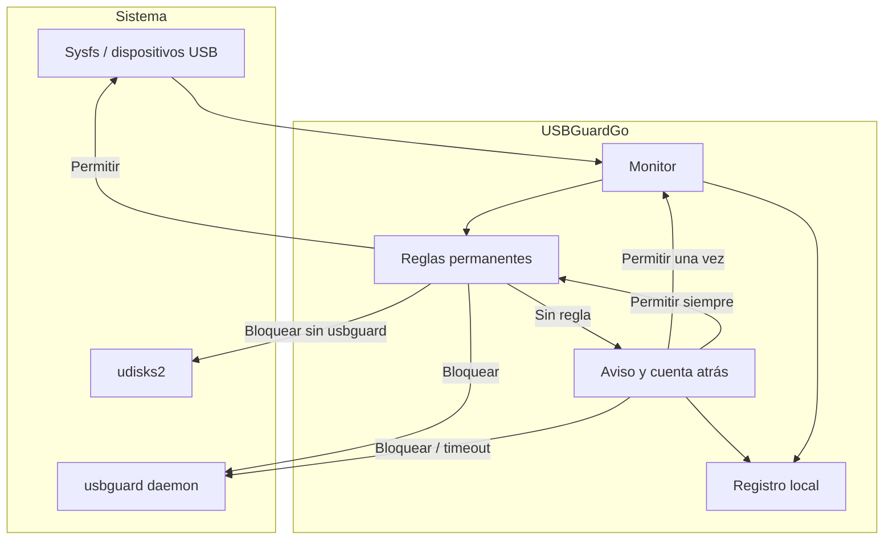

# Cómo funciona USBGuardGo

USBGuardGo es una capa de decisión entre los puertos USB y el sistema. No confía en que el usuario esté mirando, no confía en los nombres de los dispositivos y no interpreta el silencio como un permiso.

## Vista general



La aplicación tiene cuatro responsabilidades:

1. **Detectar** qué dispositivos USB están conectados.
2. **Decidir** si cada uno está permitido, bloqueado o pendiente.
3. **Preguntar** cuando no hay una decisión previa.
4. **Aplicar** la decisión con el mecanismo disponible en el sistema.

## Detección

La fuente principal es `sysfs`, el árbol virtual del kernel Linux. USBGuardGo lee la lista de dispositivos en `/sys/bus/usb/devices` y obtiene:

- Identificador de fabricante y producto (`VID:PID`).
- Fabricante, producto y, si existe, número de serie.
- Clase de interfaz (almacenamiento, HID, audio, cámara, etc.).
- Puerto físico y si el dispositivo es interno o extraíble.

`sysfs` está siempre disponible y es de solo lectura: detectar no requiere root ni un demonio. Si por algún motivo no se puede leer, la aplicación intenta `lsusb` como respaldo.

El monitor compara la lista cada pocos segundos. Los dispositivos que aparecen se clasifican como nuevos; los que desaparecen se marcan como desconectados. La primera foto se toma en silencio para no confundir lo que ya estaba conectado con una conexión nueva.

### Por qué hay un intervalo

El sondeo integrado no es instantáneo: trabaja con un intervalo corto (2 segundos). Es suficiente para el uso normal, pero un ataque BadUSB muy rápido podría actuar antes de la siguiente lectura. Para eso existe la integración con el demonio `usbguard`, que aplica políticas a nivel de kernel y no depende del sondeo de la interfaz.

## Identidad de un dispositivo

Cada dispositivo se identifica por:

```text
VID:PID[:serie]
```

- `VID` es el identificador del fabricante.
- `PID` es el identificador del producto.
- La serie, cuando existe, distingue dos unidades del mismo modelo.

Ejemplo: `0781:5567` puede ser un modelo de pendrive; `0781:5567:ABC123` es una unidad concreta.

### Precedencia de reglas

Si hay varias reglas que podrían aplicar, gana la más específica:

1. Una regla con **VID, PID y serie exactos**.
2. Una regla con **VID y PID** (sin serie).

Esto permite permitir tu teclado concreto sin permitir todos los teclados del mismo modelo. También permite bloquear una unidad perdida sin bloquear el modelo entero.

## Estados de un dispositivo

| Estado | Significado | Qué hace el monitor |
|---|---|---|
| **Permitido** | Hay una regla de permiso o un permiso de sesión | Lo deja pasar |
| **Bloqueado** | Hay una regla de bloqueo | Lo neutraliza |
| **Pendiente** | No hay regla ni permiso vigente | Muestra el aviso |
| **En pausa** | La protección global está desactivada | Permite sin preguntar |

## El aviso y la cuenta atrás

Cuando aparece un dispositivo pendiente, USBGuardGo muestra un aviso con:

- Nombre y tipo del dispositivo.
- `VID:PID` y serie, si está disponible.
- Tres acciones: **Una vez**, **Siempre** y **Bloquear**.
- Una cuenta atrás visible.

La cuenta atrás es la pieza central del diseño **fail-closed**. Si el usuario no está delante, el aviso no queda abierto indefinidamente: al llegar a cero, el dispositivo se bloquea. Lo mismo ocurre si se cierra el aviso sin elegir.

El tiempo se configura entre 5 y 300 segundos. Un valor corto es más seguro pero más incómodo; un valor largo da margen para decidir, a costa de dejar el dispositivo en espera.

## Permisos de sesión frente a reglas permanentes

| Acción | Alcance | Se guarda |
|---|---|---|
| **Una vez** | Mientras el dispositivo siga conectado | No |
| **Siempre** | Hasta que se borre la regla | Sí, en `config.json` |
| **Bloquear** | Hasta que se borre la regla | Sí, en `config.json` |

Los permisos de sesión viven solo en memoria. No se escriben en disco, no sobreviven a un reinicio y desaparecen al desconectar el dispositivo. Son la opción correcta para un USB prestado.

## Aplicación del bloqueo

USBGuardGo tiene dos motores:

### 1. usbguard (kernel)

Si el comando `usbguard` está instalado y el demonio está funcionando, USBGuardGo le pide que permita o bloquee el dispositivo. El bloqueo se aplica en el nivel del kernel, antes de que el dispositivo sea utilizable por el sistema.

Es el modo recomendado. El Panel lo muestra como **motor usbguard**.

### 2. Vigilancia integrada y bloqueo suave

Si `usbguard` no está disponible, USBGuardGo usa su propio monitor y aplica un bloqueo suave:

1. Localiza los discos y particiones que cuelgan del dispositivo.
2. Desmonta las particiones montadas.
3. Apaga el dispositivo mediante `udisksctl`.

El bloqueo suave no puede neutralizar dispositivos que no son almacenamiento (un teclado, una cámara) de la misma forma que el kernel. En esos casos, la aplicación mantiene la regla de bloqueo y muestra el estado, pero la eficacia depende de las capacidades del sistema. El Panel indica siempre qué motor está activo.

## Primera ejecución

En el primer arranque, USBGuardGo:

1. Lee los dispositivos conectados.
2. Los registra como permitidos para siempre.
3. Marca la primera ejecución como completada.
4. Muestra una explicación.

El objetivo es evitar que el teclado, el ratón, la cámara integrada o el disco de arranque generen avisos que el usuario no puede resolver. Esas reglas son normales y se pueden revisar o borrar en cualquier momento.

## Protección en segundo plano

La ventana y el monitor son independientes:

- Cerrar la ventana la oculta en la bandeja si el escritorio tiene bandeja.
- El monitor sigue activo.
- El menú de la bandeja permite mostrar, activar/desactivar la protección y salir.
- Si el escritorio no tiene bandeja, cerrar la ventana termina la aplicación.

El modo `--tray` arranca sin ventana y se usa para el inicio automático. En la primera ejecución siempre se muestra la ventana, porque el onboarding no puede ser invisible.

## Configuración y registro

La configuración se guarda en `~/.config/usbguardgo/config.json`:

- Reglas permanentes.
- Idioma.
- Tiempo de espera.
- Estado de la protección.
- Preferencia de arranque automático.
- Contadores de telemetría, si se activan.

El archivo se escribe de forma atómica (archivo temporal + renombrado) y con permisos `600`; la carpeta se crea con `700`. El registro `usbguardgo.log` se rota automáticamente para no crecer sin límite.

## Privacidad por diseño

- No hay conexiones de red para el funcionamiento.
- La telemetría está apagada por defecto y solo cuenta eventos agregados.
- Los nombres y números de serie se guardan localmente porque forman parte de las reglas.
- El registro solo sale del equipo si el usuario lo exporta y lo comparte.

## Límites conocidos

USBGuardGo es una capa de defensa, no una garantía absoluta:

- El sondeo integrado tiene un intervalo; no es instantáneo.
- El bloqueo suave depende de `udisksctl` y está orientado a almacenamiento.
- Un dispositivo que se haga pasar por uno ya permitido (mismo VID/PID y misma serie) no se distingue por estas reglas.
- Un ataque con acceso físico y root puede desactivar la aplicación.
- La aplicación no analiza el contenido del dispositivo ni ejecuta antivirus.
- No sustituye al cifrado, al control de acceso, a las copias de seguridad ni a una política de seguridad organizativa.

Para una protección más fuerte, instala y configura `usbguard` y mantén el sistema actualizado.
